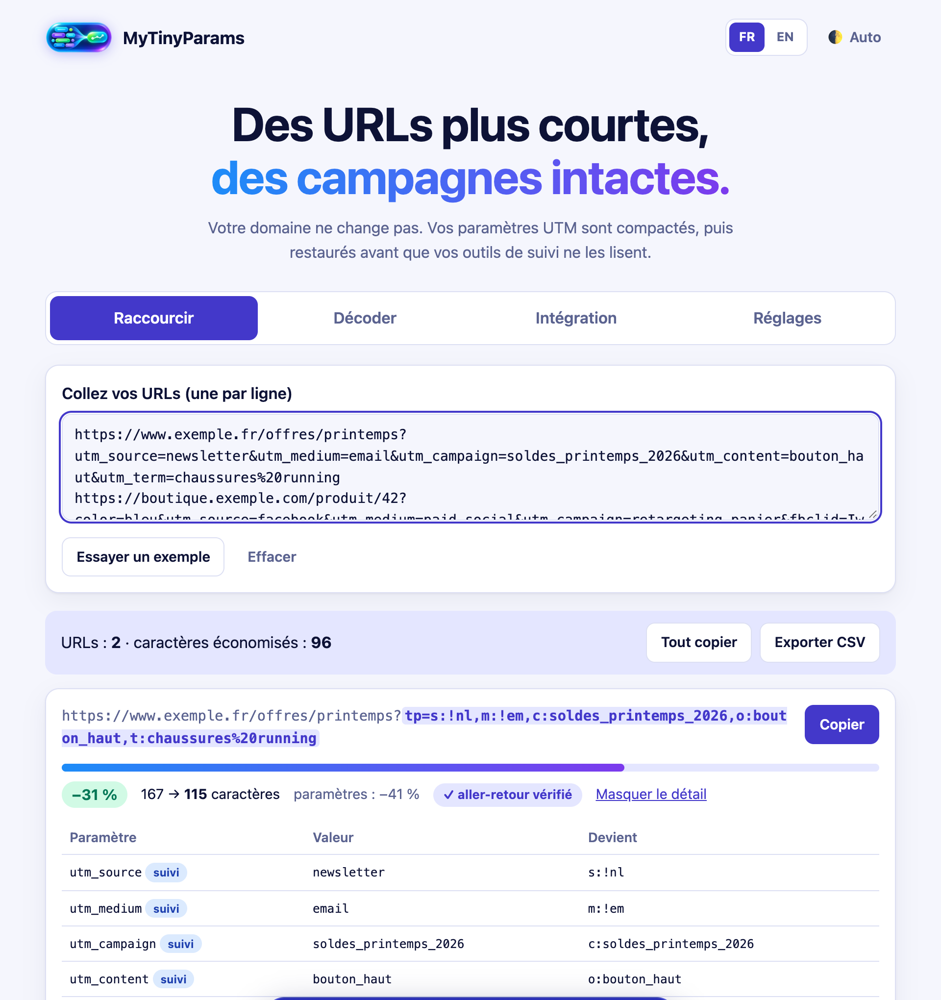
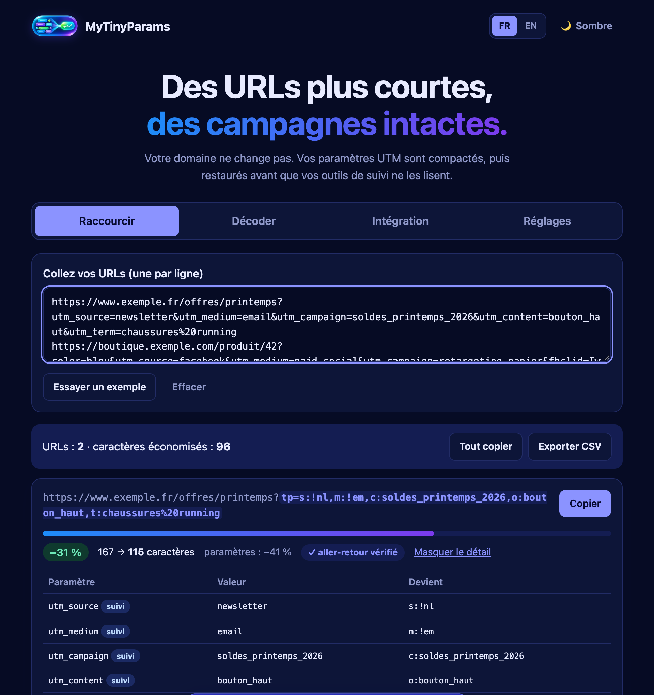
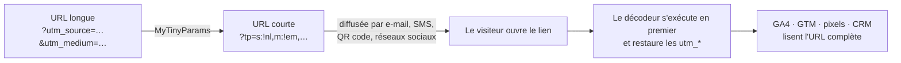
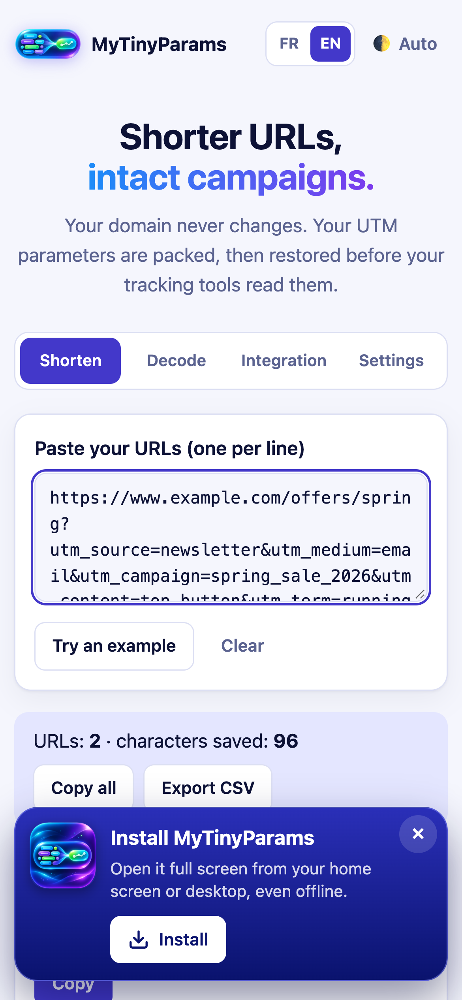
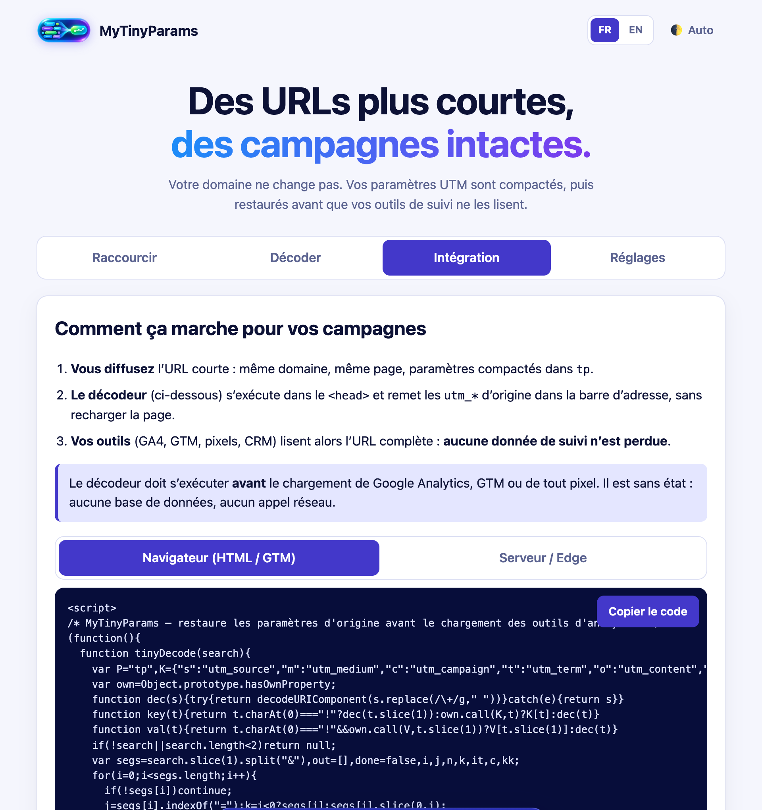

<div align="center">


# MyTinyParams

**Des URLs plus courtes, des campagnes intactes.**
Raccourcissez la chaîne de paramètres de n'importe quelle URL — UTM et identifiants de clic compris — **sans jamais toucher au domaine**.

[](https://github.com/rodolphe37/my-tiny-params/actions/workflows/ci.yml)
[](https://mytinyparams.netlify.app/)
[](LICENSE)
[](#-pwa-installable)
[](#-bilingue)
[](package.json)

[English](README.md) · **Français**

### 🌐 [**Essayer en ligne → mytinyparams.netlify.app**](https://mytinyparams.netlify.app/)

</div>

<p align="center">
  
  
</p>

## ✨ Pourquoi

Les liens de campagne deviennent vite interminables :

```text
https://www.exemple.fr/offres/printemps?utm_source=newsletter&utm_medium=email&utm_campaign=soldes_printemps_2026&utm_content=bouton_haut&utm_term=chaussures%20running
```

Moches dans un SMS, lourds dans un QR code, tronqués dans un post, pénibles à lire dans le source d'un e-mail. Les raccourcisseurs
classiques règlent la longueur mais **remplacent votre domaine** : vous perdez la confiance dans la marque, la délivrabilité et la maîtrise du lien.

MyTinyParams garde votre domaine et votre chemin **tels quels** et ne compacte que les *paramètres* :

```text
https://www.exemple.fr/offres/printemps?tp=s:!nl,m:!em,c:soldes_printemps_2026,o:bouton_haut,t:chaussures%20running
```

Ici, **−31 % sur l'URL entière** et **−41 % sur les paramètres eux-mêmes** — totalement **réversible**, **sans rien stocker** : ni base de données, ni compte, ni serveur.

## 🔁 Comment ça marche



1. **Raccourcir** — collez vos URLs dans l'app ; les paramètres de suivi sont regroupés dans un seul paramètre court.
2. **Diffuser** — même domaine, même page, lien plus court.
3. **Restaurer** — un petit décodeur sans dépendance, sur votre site, remet les `utm_*` d'origine dans la barre d'adresse
   (`history.replaceState`, sans rechargement) **avant** le chargement de vos outils d'analytics. Ils ne voient aucune différence.

> [!IMPORTANT]
> Le décodeur doit s'exécuter **avant** Google Analytics, GTM ou tout pixel. Sinon ils verraient `tp=…` au lieu de vos UTM.
> L'app génère le snippet exact correspondant à vos réglages dans l'onglet **Intégration**.

## 🚀 Fonctionnalités

- **Domaine, chemin, ancre et ordre des paramètres jamais modifiés.**
- **Réversible et sans état** — le décodage est purement algorithmique ; pas de base de données, pas d'appel réseau.
- **Aller-retour vérifié** sur chaque lien : l'app décode sa propre sortie et contrôle qu'elle correspond à l'original.
- **Dictionnaire intégré** de 26 paramètres de suivi (`utm_*`, `gclid`, `fbclid`, `msclkid`, `ttclid`, `_ga`, …) et de
  35 valeurs fréquentes (`newsletter`, `email`, `paid_social`, `facebook`, …) — plus **vos propres alias**
  (`bf26` → `black_friday_2026`).
- **Deux portées** — *Suivi uniquement* (les paramètres métier comme `page` ou `tri` restent lisibles) ou *Tous les paramètres* (gain maximal).
- **Mode lot** — une URL par ligne, « Tout copier » et export CSV.
- **Décodeurs prêts à coller** — snippet navigateur (HTML / GTM) et fonction serveur / edge (middleware Next.js, Cloudflare Worker…).
- **Sûr par construction** — collision avec un paramètre `tp` existant gérée ; une URL courte n'est rendue que si elle est réellement plus courte.
- **100 % local** — vos URLs ne quittent jamais votre navigateur. Aucun cookie publicitaire ; les visites du site public ne sont comptées (MyAnalyticsPro) que si le visiteur l’accepte.

### 📲 PWA installable

Fonctionne hors ligne et s'installe comme une app native : invitation flottante « Installer » sur Chromium, aide
*Partager → Sur l'écran d'accueil* sur Safari iPhone / iPad, et carte dans les Réglages. Les nouvelles versions s'installent à la demande (sans perdre votre saisie).

<p align="center">
  
  
</p>

### 🌍 Bilingue

Français et anglais, détectés depuis le navigateur au premier lancement et modifiables à tout moment. Tous les textes sont dans
`src/i18n/` ; `fr.ts` fait foi et `en.ts` doit définir exactement les mêmes clés (vérifié par le compilateur **et** par un test).

## 📦 Démarrage rapide

```bash
git clone https://github.com/rodolphe37/my-tiny-params.git
cd my-tiny-params
npm install
npm run dev        # http://localhost:5173
```

| Script            | Ce qu'il fait                                                                  |
| ----------------- | ------------------------------------------------------------------------------ |
| `npm run dev`     | Serveur de développement avec rechargement à chaud                             |
| `npm test`        | Codec, équivalence du snippet décodeur, parité i18n, pages légales, routage    |
| `npm run build`   | Vérification des types + build de production (PWA incluse)                     |
| `npm run preview` | Sert le build de production (pour essayer le service worker)                   |
| `npm run icons`   | Régénère les icônes et le logo depuis `design/`                                |

Node 22 (voir `.nvmrc`).

## 🧩 Utiliser le codec dans votre code

`src/lib/codec.ts` et `src/lib/dictionary.ts` sont du TypeScript pur, **sans aucune dépendance** — copiez-les où vous voulez.

```ts
import { encodeUrl, decodeUrl, DEFAULT_OPTIONS } from './codec'

const r = encodeUrl('https://exemple.fr/p?utm_source=newsletter&utm_medium=email&utm_campaign=printemps')
r.output     // https://exemple.fr/p?tp=s:!nl,m:!em,c:printemps
r.savedChars // 35
r.roundTrip  // true

decodeUrl(r.output).output // https://exemple.fr/p?utm_source=newsletter&utm_medium=email&utm_campaign=printemps
```

## 📐 Format des liens (v1)

```text
?tp=s:!nl,m:!em,c:soldes_2026
     │ │   │
     │ │   └─ valeur littérale (encodée en pourcentage)
     │ └───── « ! » + code du dictionnaire  (!nl = newsletter)
     └─────── code de clé du dictionnaire   (s = utm_source)
```

| Élément               | Règle                                                                                              |
| --------------------- | -------------------------------------------------------------------------------------------------- |
| Conteneur             | Un seul paramètre, `tp` par défaut (configurable), à la place du premier paramètre regroupé        |
| Paires / clé-valeur   | Paires séparées par `,`, clé et valeur par `:` ; un paramètre sans valeur est simplement sa clé    |
| Clé                   | Code du dictionnaire (`s`, `m`, `c`, `g`, `f`…) ou `!` + clé littérale encodée                     |
| Valeur                | `!code` du dictionnaire / de vos alias, ou littéral encodé (`!` lui-même → `%21`)                  |
| Caractères structurels| `,` `:` `!` sont des caractères *réservés* : aucun proxy ne normalise leurs formes encodées         |
| Intact                | Domaine, chemin, ancre et (en portée *Suivi uniquement*) tout paramètre qui n'est pas du suivi     |

> [!WARNING]
> **Le format v1 et les dictionnaires intégrés sont figés.** Les liens déjà diffusés doivent continuer à se décoder.
> On peut *ajouter* des entrées, jamais en modifier ni en retirer. Les alias personnalisés suivent la même règle : ne modifiez ni ne supprimez un alias déjà présent dans un lien diffusé.

## 🔌 Notes de compatibilité

- **GA4 / GTM / pixels** lisent l'URL au moment de l'envoi du hit : installez le décodeur en premier (head, ou balise GTM *Consent Initialization*).
- **Identifiants de clic** (`gclid`, `fbclid`…) : jetons opaques, non compressibles — seul le nom de la clé raccourcit.
- **Attribution uniquement côté serveur ?** Utilisez le snippet serveur / edge pour restaurer l'URL complète avant le rendu.
- Les plateformes publicitaires et les aperçus de liens voient l'URL courte telle quelle : elle reste une URL normale sur votre domaine.

## 🏗️ Structure du projet

```text
src/
├── lib/
│   ├── codec.ts          # encodeUrl / decodeUrl — le cœur du projet (sans dépendance)
│   ├── dictionary.ts     # dictionnaires de clés et de valeurs, figés
│   ├── snippet.ts        # génère les décodeurs navigateur / serveur
│   ├── pwa.ts            # logique d'installation (beforeinstallprompt, aide iOS Safari)
│   └── route.ts          # routeur minimal (accueil, /legal, /terms)
├── i18n/                 # fr.ts (fait foi), en.ts, textes légaux, provider
├── components/           # onglets, invitation d'installation, bandeau de mise à jour, pages légales…
└── styles.css
scripts/make-icons.mjs    # icônes + logo depuis design/
design/                   # identité visuelle (voir design/README.md)
```

## ☁️ Déploiement

Le dépôt contient un `netlify.toml` prêt à l'emploi : build `npm run build`, publication de `dist/`, Node 22, repli SPA, pas de cache
pour le service worker / manifeste / `index.html`, cache longue durée pour les fichiers à empreinte.

[](https://app.netlify.com/start/deploy?repository=https://github.com/rodolphe37/my-tiny-params)

L'instance officielle tourne sur **[mytinyparams.netlify.app](https://mytinyparams.netlify.app/)**. Tout hébergeur statique convient (Vercel, Cloudflare Pages, GitHub Pages…) : servez `dist/` et renvoyez les chemins inconnus vers `index.html`.
`/version.json` indique la version en ligne.

## 🛠️ Technologies

React 19 · Vite · TypeScript · Vitest · vite-plugin-pwa (Workbox) · CSS simple (clair / sombre / auto) — aucun framework d'UI, aucune
dépendance d'exécution hormis React.

## 🤝 Contribuer

Issues et pull requests bienvenues — voir [CONTRIBUTING.md](CONTRIBUTING.md). Les règles tiennent en quatre lignes : garder le
format v1 figé, ajouter les textes dans **les deux** langues, ajouter des tests, incrémenter la version.
Une faille de sécurité ? Suivez [SECURITY.md](SECURITY.md).

## 📄 Licence

Code source : [MIT](LICENSE) © 2026 Rodolphe Augusto.
Le **nom, le logo et l'icône** du dossier `design/` (et les images qui en dérivent) ne sont *pas* couverts par la licence MIT — voir
[design/README.md](design/README.md). Le service hébergé est régi par ses propres mentions légales et CGU (`/legal`, `/terms`).

<div align="center">

Fait avec soin par [Rodolphe Augusto](https://github.com/rodolphe37)

</div>
