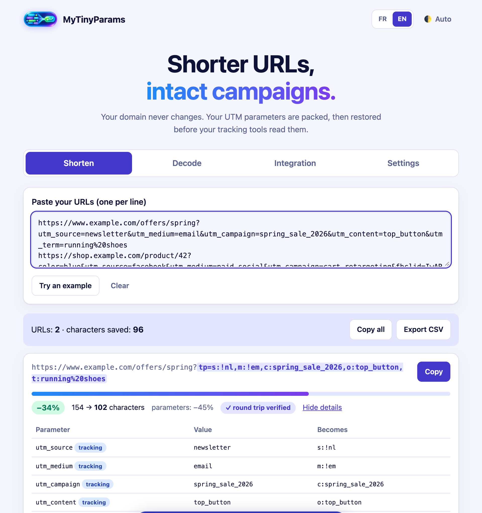
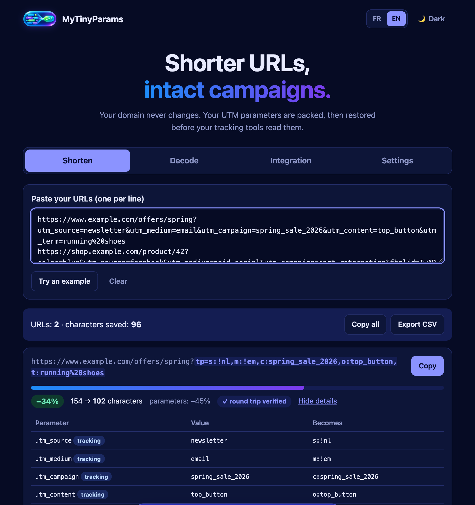
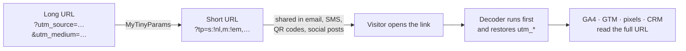
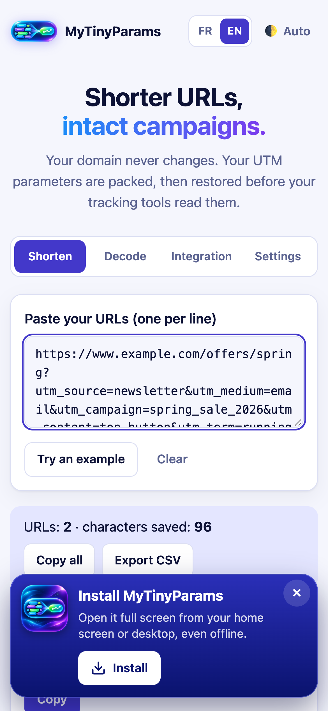
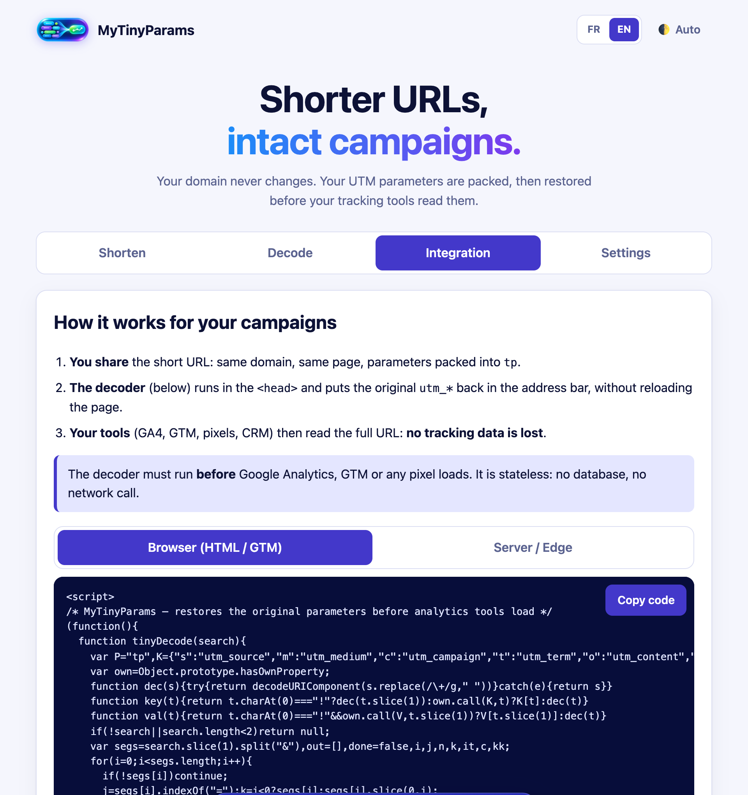

<div align="center">


# MyTinyParams

**Shorter URLs, intact campaigns.**
Shrink the query string of any URL — UTM and click-ID tracking included — **without ever touching the domain**.

[](https://github.com/rodolphe37/my-tiny-params/actions/workflows/ci.yml)
[](LICENSE)
[](#-installable-pwa)
[](#-bilingual)
[](package.json)

**English** · [Français](README.fr.md)

</div>

<p align="center">
  
  
</p>

## ✨ Why

Campaign links get long fast:

```text
https://www.example.com/offers/spring?utm_source=newsletter&utm_medium=email&utm_campaign=spring_sale_2026&utm_content=top_button&utm_term=running%20shoes
```

They are ugly in an SMS, heavy in a QR code, truncated in social posts, and clumsy to read in an email source. Classic URL
shorteners fix the length but **replace your domain** — you lose brand trust, deliverability and control.

MyTinyParams keeps your domain and path **exactly as they are** and only compacts the *parameters*:

```text
https://www.example.com/offers/spring?tp=s:!nl,m:!em,c:spring_sale_2026,o:top_button,t:running%20shoes
```

Here that is **34 % shorter on the whole URL** and **45 % on the parameters themselves** — fully **reversible**, with **nothing to store**: no database, no account, no server.

## 🔁 How it works



1. **Shorten** — paste URLs in the app; the tracking parameters are packed into a single short parameter.
2. **Share** — same domain, same page, shorter link.
3. **Restore** — a tiny, dependency-free decoder on your site puts the original `utm_*` back in the address bar
   (`history.replaceState`, no reload) **before** your analytics load. Your tools never notice anything.

> [!IMPORTANT]
> The decoder must run **before** Google Analytics, GTM or any pixel. Otherwise they would see `tp=…` instead of your UTMs.
> The app generates the exact snippet for your settings in the **Integration** tab.

## 🚀 Features

- **Domain, path, fragment and parameter order are never altered.**
- **Reversible and stateless** — decoding is purely algorithmic; no database, no network call.
- **Round-trip verified** on every link: the app decodes its own output and checks it matches the original.
- **Built-in dictionary** of 26 tracking parameters (`utm_*`, `gclid`, `fbclid`, `msclkid`, `ttclid`, `_ga`, …) and
  35 frequent values (`newsletter`, `email`, `paid_social`, `facebook`, …) — plus **your own aliases**
  (`bf26` → `black_friday_2026`).
- **Two scopes** — *Tracking only* (business parameters like `page` or `sort` stay readable) or *All parameters* (maximum savings).
- **Batch mode** — one URL per line, "Copy all" and CSV export.
- **Ready-to-paste decoders** — browser snippet (HTML / GTM) and server / edge function (Next.js middleware, Cloudflare Worker…).
- **Safe by construction** — collision with an existing `tp` parameter is handled; a short URL is only returned if it is really shorter.
- **100 % local** — your URLs never leave your browser. No tracking, no cookies.

### 📲 Installable PWA

Works offline and installs like a native app: a floating install prompt on Chromium, *Share → Add to Home Screen* guidance
on iPhone / iPad Safari, and a card in Settings. New versions install on demand (no lost input).

<p align="center">
  
  
</p>

### 🌍 Bilingual

French and English, detected from the browser on first launch and switchable at any time. All texts live in `src/i18n/`;
`fr.ts` is the source of truth and `en.ts` must define exactly the same keys (enforced by the compiler **and** a test).

## 📦 Quick start

```bash
git clone https://github.com/rodolphe37/my-tiny-params.git
cd my-tiny-params
npm install
npm run dev        # http://localhost:5173
```

| Script            | What it does                                                        |
| ----------------- | ------------------------------------------------------------------- |
| `npm run dev`     | Dev server with hot reload                                          |
| `npm test`        | Codec, decoder-snippet equivalence, i18n parity, legal pages, routing |
| `npm run build`   | Type-check + production build (PWA included)                        |
| `npm run preview` | Serve the production build (to try the service worker)              |
| `npm run icons`   | Regenerate icons and logo from `design/`                            |

Node 22 (see `.nvmrc`).

## 🧩 Use the codec in your own code

`src/lib/codec.ts` and `src/lib/dictionary.ts` are pure TypeScript with **zero dependencies** — copy them anywhere.

```ts
import { encodeUrl, decodeUrl, DEFAULT_OPTIONS } from './codec'

const r = encodeUrl('https://example.com/p?utm_source=newsletter&utm_medium=email&utm_campaign=spring')
r.output     // https://example.com/p?tp=s:!nl,m:!em,c:spring
r.savedChars // 35
r.roundTrip  // true

decodeUrl(r.output).output // https://example.com/p?utm_source=newsletter&utm_medium=email&utm_campaign=spring
```

## 📐 Link format (v1)

```text
?tp=s:!nl,m:!em,c:spring_2026
     │ │   │
     │ │   └─ literal value (percent-encoded)
     │ └───── "!" + code from the dictionary  (!nl = newsletter)
     └─────── key code from the dictionary    (s = utm_source)
```

| Part              | Rule                                                                                            |
| ----------------- | ----------------------------------------------------------------------------------------------- |
| Container         | One parameter, `tp` by default (configurable), placed where the first packed parameter was      |
| Pairs / key-value | Pairs separated by `,`, key and value by `:`; a parameter without value is just its key         |
| Key               | Dictionary code (`s`, `m`, `c`, `g`, `f`…) or `!` + percent-encoded literal key                 |
| Value             | `!code` from the dictionary / your aliases, or a percent-encoded literal (`!` itself → `%21`)   |
| Structural chars  | `,` `:` `!` are *reserved* characters: proxies never normalise their percent-encoded forms      |
| Untouched         | Domain, path, fragment, and (in *Tracking only* scope) every non-tracking parameter             |

> [!WARNING]
> **The v1 format and the built-in dictionaries are frozen.** Links already shared in the wild must keep decoding.
> Entries can be *added*, never changed or removed. Custom aliases follow the same rule: don't edit or delete one that is already in a shared link.

## 🔌 Compatibility notes

- **GA4 / GTM / pixels** read the URL when the hit is sent: install the decoder first (head, or a GTM *Consent Initialization* tag).
- **Click IDs** (`gclid`, `fbclid`…) are opaque tokens and can't be compressed — only their key name shrinks.
- **Server-side attribution only?** Use the server / edge snippet to restore the full URL before rendering.
- Ad platforms and link previews see the short URL as-is; it stays a normal URL on your own domain.

## 🏗️ Project structure

```text
src/
├── lib/
│   ├── codec.ts          # encodeUrl / decodeUrl — the heart of the project (no dependencies)
│   ├── dictionary.ts     # frozen key & value dictionaries
│   ├── snippet.ts        # generates the browser / server decoders
│   ├── pwa.ts            # install prompt logic (beforeinstallprompt, iOS Safari hint)
│   └── route.ts          # minimal router (home, /legal, /terms)
├── i18n/                 # fr.ts (source of truth), en.ts, legal texts, provider
├── components/           # tabs, install prompt, update banner, legal pages…
└── styles.css
scripts/make-icons.mjs    # icons + logo from design/
design/                   # brand assets (see design/README.md)
```

## ☁️ Deploy

The repo ships a ready-to-use `netlify.toml`: build `npm run build`, publish `dist/`, Node 22, SPA fallback, no-cache for the
service worker / manifest / `index.html`, long-term cache for fingerprinted assets.

[](https://app.netlify.com/start/deploy?repository=https://github.com/rodolphe37/my-tiny-params)

Any static host works (Vercel, Cloudflare Pages, GitHub Pages…): serve `dist/` and route unknown paths to `index.html`.
`/version.json` tells which version is live.

## 🛠️ Tech stack

React 19 · Vite · TypeScript · Vitest · vite-plugin-pwa (Workbox) · plain CSS (light / dark / auto) — no UI framework, no runtime
dependency beyond React.

## 🤝 Contributing

Issues and pull requests are welcome — see [CONTRIBUTING.md](CONTRIBUTING.md). The ground rules fit in four lines: keep
the v1 format frozen, add texts in **both** languages, add tests, bump the version.
Found a vulnerability? Please follow [SECURITY.md](SECURITY.md).

## 📄 License

Source code: [MIT](LICENSE) © 2026 Rodolphe Augusto.
The **name, logo and icon** in `design/` (and the images derived from them) are *not* covered by the MIT license — see
[design/README.md](design/README.md). The hosted service is governed by its own legal notice and terms of use (`/legal`, `/terms`).

<div align="center">

Made with care by [Rodolphe Augusto](https://github.com/rodolphe37)

</div>
